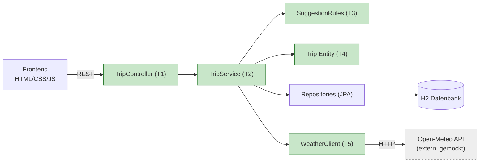

# Testkonzept Packliste

## Introduction

Packliste ist eine kleine Web-Applikation für Reise-Packlisten. Man erstellt eine Reise
(Ziel aus einer festen Städteliste, Start- und Enddatum) und führt dazu eine Liste mit
Gegenständen, die man abhaken oder löschen kann. Zusätzlich schlägt die Applikation
Gegenstände vor. Dafür holt das Backend die Wettervorhersage bei Open-Meteo und wendet
einfache Regeln an, zum Beispiel Regen gibt Regenjacke, unter 10 °C gibt warme Jacke.

Technik: Spring Boot 3 mit Java 21 und Maven, Spring Data JPA mit H2, REST-API. Das Frontend
ist einfaches HTML/CSS/JavaScript und wird vom Backend ausgeliefert.

## Big Picture (Test Items)

Die grün markierten Komponenten sind Test Items. Die Open-Meteo API ist extern und wird in
den Tests weggemockt.

| Item | Komponente | Testart |
|---|---|---|
| T1 | `TripController` (REST-API) | Integrationstest |
| T2 | `TripService` | Unit Test mit Mocks, Integrationstest |
| T3 | `SuggestionRules` | Unit Test (TDD) |
| T4 | `Trip` (Reisedauer) | Unit Test (TDD) |
| T5 | `WeatherClient` | Test gegen gemockten Server |

## Test Features

| Feature | Item | Was geprüft wird |
|---|---|---|
| Reisedauer | T4 | Dauer in Tagen, Start und Ende zählen mit |
| Reise erstellen | T1, T2 | Reise wird gespeichert, Enddatum vor Startdatum und Reisen über 30 Tage werden abgelehnt |
| Gegenstände verwalten | T1, T2 | Hinzufügen, abhaken, löschen |
| Vorschläge | T2, T3 | Regenjacke bei Regen, warme Jacke unter 10 °C, Sonnencreme über 25 °C, Anzahl T-Shirts nach Reisedauer |
| Wetterdaten holen | T5 | Richtige Anfrage an Open-Meteo, Antwort wird richtig gelesen, Fehler der API werden abgefangen |
| API mit Datenbank | T1 | Ablauf Controller, Service, H2 zusammen über HTTP-Requests |

## Features not to be tested

| Was | Warum nicht |
|---|---|
| Open-Meteo API selber | Externer Dienst, nicht unter meiner Kontrolle. Wird gemockt, sonst hängen die Tests vom Netz und vom Wetter ab. |
| Spring Boot, JPA, H2 | Framework und Datenbank testet der Hersteller. Ich teste nur meinen Code, der sie verwendet. |
| Frontend (HTML/JS) | Sehr dünn, nur Anzeige und Aufrufe der API. Wird von Hand im Browser geprüft, keine automatischen UI-Tests. |
| Performance, Last, Sicherheit | Nicht Teil der Anforderungen für dieses kleine Projekt. |

## Testvorgehen

Die Business-Logik (Reisedauer, Validierung beim Erstellen einer Reise und Vorschlagsregeln)
setze ich nach TDD um. Ablauf pro Regel:

1. **Red**: Test schreiben, der fehlschlägt. Commit mit "(rot)".
2. **Green**: So wenig Code wie nötig, bis der Test grün ist. Commit mit "(gruen)".
3. **Refactor**: Aufräumen, Tests bleiben grün.

Für Controller, Repository-Anbindung und den Wetter-Client schreibe ich die Tests nicht
strikt zuerst, sondern direkt nach dem Code. Dort geht es mehr um Zusammenspiel als um
Logik, und TDD bringt dort wenig.

Teststufen:

- **Unit Tests** (JUnit 5): `Trip`, `SuggestionRules`, `TripService`. Im Service werden
  Repository und Wetter-Client mit Mockito gemockt.
- **Integrationstests** (`@SpringBootTest` mit MockMvc): HTTP-Request bis in die H2-Datenbank.
  Der Wetter-Client wird mit `@MockitoBean` ersetzt.
- **Schnittstellentest**: `WeatherClient` gegen einen gemockten Server (`MockRestServiceServer`).

Neue Features kommen über einen Feature-Branch und einen Pull Request mit Code Review auf `main`.

## Kriterien

Ein Testlauf gilt als erfolgreich, wenn:

- alle Tests grün sind und
- die Line Coverage (JaCoCo) mindestens 80 % ist. Darunter bricht `mvn verify` ab.

Ein Test gilt als fehlgeschlagen, wenn eine Assertion fehlschlägt oder eine unerwartete
Exception auftritt. Fehler teile ich pragmatisch ein:

- **Gering**: Kleinere Schönheitsfehler oder ungenaue Texte, Kernlogik funktioniert.
- **Mittel**: Eine Funktion liefert falsche Daten (z.B. falsche Pack-Vorschläge).
- **Schwer**: Applikation startet nicht, Daten gehen verloren oder Requests werfen 500er-Fehler.

Schwere Fehler haben Vorrang und werden vor neuen Features gefixt.

## Testumgebung

| Tool | Wofür |
|---|---|
| JUnit 5 | Unit- und Integrationstests |
| Mockito | Mocks für Repository und Wetter-Client |
| Spring Boot Test, MockMvc | Integrationstests über die REST-API |
| MockRestServiceServer | Gemockter Open-Meteo-Server für den `WeatherClient` |
| H2 (in-memory) | Datenbank für Applikation und Tests |
| Maven Surefire | Testresultate als Report |
| JaCoCo | Code Coverage als Report |
| GitHub Actions | Pipeline mit Build, Test und Deploy der Reports bei jedem Push und Pull Request |

Lokal: Windows 11, Java 21 (Temurin), Maven 3.9. In der Pipeline: `ubuntu-latest` mit Java 21.

## Planung

| Bis | Was |
|---|---|
| 2026-09-14 | Testkonzept, Grundgerüst des Projekts |
| 2026-09-21 | Reisen und Gegenstände, Reisedauer und Vorschlagsregeln mit TDD |
| 2026-09-28 | Wetter-Client mit Mock-Server-Test, Service-Tests mit Mockito, Integrationstests |
| 2026-10-05 | Pipeline mit Build, Test und Deploy der Reports |
| 2026-10-19 | Drei kleine Features über Pull Requests mit Code Review |
| 2026-10-27 | LB2, in dieser Woche keine Projektarbeit |
| 2026-11-02 | README, Reflexion, Präsentation vorbereiten |
| 2026-11-03 | Abgabe und Präsentation |
